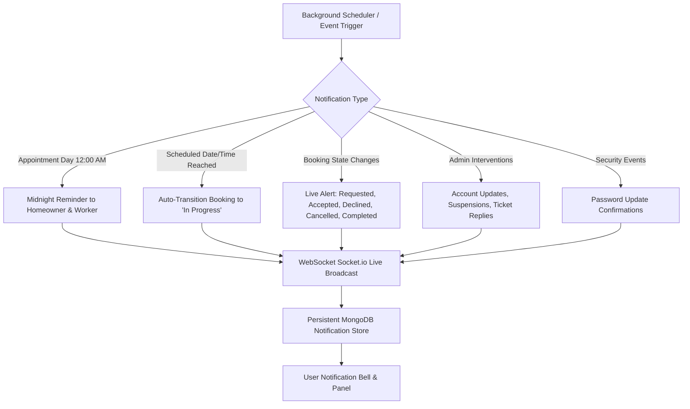
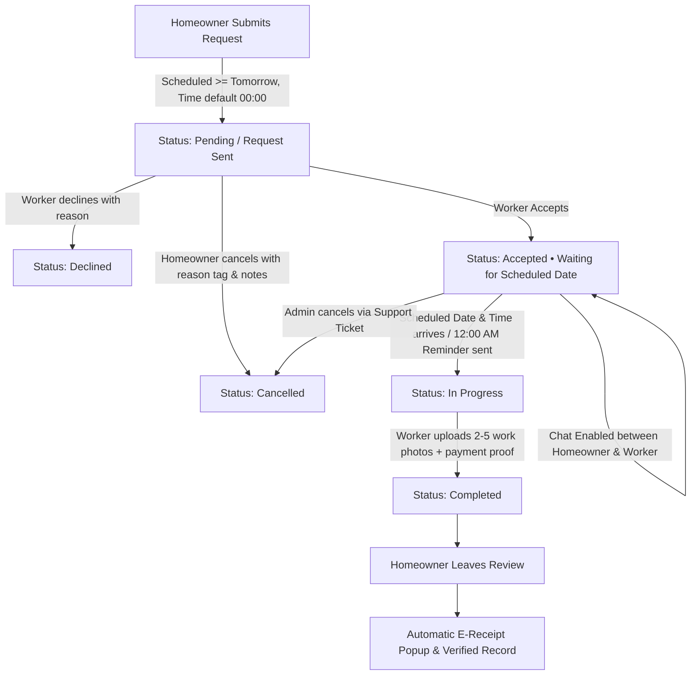

# TrabaHome 🏠🛠️
**On-Demand Home Services Marketplace for Pangasinan, Philippines**

[](https://react.dev/)
[](https://www.typescriptlang.org/)
[](https://tailwindcss.com/)
[](https://vite.dev/)
[](https://nodejs.org/)
[](https://expressjs.com/)
[](https://www.mongodb.com/)
[](https://socket.io/)
[](https://leafletjs.com/)
[](https://vercel.com/)
[](https://render.com/)

TrabaHome is an on-demand, web-based service marketplace engineered to bridge homeowners with verified, local skilled tradespeople across Pangasinan, Philippines. From carpentry, electrical, and plumbing to masonry, appliance repair, and painting, TrabaHome provides a safe, transparent, and seamless platform featuring identity verification, geolocation-based matching, real-time messaging, automated booking scheduling, multi-role notifications, interactive AI assistance, and verifiable official electronic receipts (E-Receipts).

---

## 📑 Table of Contents
1. [Key Features by Role](#-key-features-by-role)
   - [Homeowners](#1-homeowner-features)
   - [Skilled Workers](#2-skilled-worker-features)
   - [Platform Administrators](#3-platform-administrator-features)
   - [TrabaHome AI Assistant](#4-trabahome-ai-assistant)
2. [Automated Notification & Scheduling Engine](#-automated-notification--scheduling-engine)
3. [Booking Lifecycle & Status Flow](#-booking-lifecycle--status-flow)
4. [Technology Stack & Deployments](#-technology-stack--deployments)
5. [Project Architecture & Directory Structure](#-project-architecture--directory-structure)
6. [Getting Started & Local Setup](#-getting-started--local-setup)
   - [Prerequisites](#prerequisites)
   - [Backend Configuration (`TrabahomeApi`)](#backend-setup-trabahomeapi)
   - [Frontend Configuration (`TrabaHome`)](#frontend-setup-trabahome)
   - [Running the Application](#running-the-application)
7. [Design Decisions & Business Rules](#-design-decisions--business-rules)
8. [License](#-license)

---

## 🌟 Key Features by Role

### 1. Homeowner Features
* **Worker Discovery & Radius Mapping**:
  * Search by trade, service category, or municipality in Pangasinan.
  * Interactive OpenStreetMap & Leaflet geolocation map with custom markers, radius filters, and worker cards.
  * Weighted ranking algorithm factoring in distance, skills match, rating score, and completed jobs.
* **Featured Services Carousel**:
  * Smooth auto-scrolling showcase with vertically centered navigation arrows aligned with icon centers.
  * Interactive click-to-pause (halts scrolling for 30 seconds upon user selection).
* **Service Booking Flow**:
  * Minimum 1-day advance scheduling rule (past and same-day dates are disabled to prevent impossible turnarounds).
  * 24-hour time selector defaulting to `00:00` with strict 15-minute intervals (`step="900"`).
  * Service description, address inputs, and photo attachment uploads.
  * Mandatory proofread modal before booking dispatch for verification of dates, times, and pricing.
* **Booking Tracking & Single-Line Action Controls**:
  * Unified, top-level progress bar on booking details:
    `Request Sent` ➔ `Accepted` ➔ `In Progress` ➔ `Completed`
  * Displays explicit Booking ID, scheduled date, and formatted 12-hour appointment time.
  * **Completed Bookings Action Bar**: Standardized, compact pill buttons aligned in a single line:
    `Completed` (Status Badge) | `E-Receipt` | `Chat` | `View Details`
* **Protected Reviews & Instant E-Receipts**:
  * Automatic E-Receipt modal popup upon review submission.
  * Submitted reviews are locked into view-only mode to prevent duplicate re-submissions.
* **Real-Time Communication**:
  * Integrated in-app chat enabled immediately once the worker accepts the job request.
  * Photo attachments and live message notifications via Socket.io.
* **One-Time Onboarding Experience**:
  * Interactive welcome guide modal presented only once upon account registration (not repeated on subsequent logins).
* **Responsive Mobile Optimization**:
  * Touch-friendly layouts, clean button wrapping, and adaptive panels designed for all mobile screen sizes.

### 2. Skilled Worker Features
* **Multi-Profession Registration**:
  * Workers can register up to 8 distinct trades/professions (Carpentry, Plumbing, Electrical, Painting, Appliance Repair, Masonry, Cleaning, General Handyman).
* **ID & Biometric Verification**:
  * Philippine Government Valid ID upload (PhilSys, Driver's License, UMID, Passport, PRC, SSS, Postal ID, Voter's ID).
  * Automated biometric facial verification and selfie matching for Verified Worker status.
* **Dynamic Worker Dashboard (`/home-worker`)**:
  * Key performance metrics: total earnings, completed jobs, rating average, and active schedule.
  * **Pending Requests Summary**: Quick review of incoming unaccepted service requests.
  * **Accepted Upcoming Jobs Summary**: At-a-glance view of confirmed appointments awaiting scheduled dates.
* **Dedicated Job Pipeline (`/worker-jobs`)**:
  * 📌 **Pending**: Unaccepted job requests with Accept and Decline actions (decline requires reason).
  * 🤝 **Accepted**: Confirmed jobs waiting for the scheduled appointment date/time. Prominently labeled `Accepted • Waiting for scheduled date`. Chat active.
  * ⏳ **In Progress**: Active jobs automatically transferred on scheduled date/time. Ready for proof-of-work submission.
  * ✅ **Completed**: Completed job history, homeowner reviews, and earnings breakdown with uniform details inspection.
* **Job Execution & E-Receipt Issuance**:
  * Submit 2–5 proof-of-work photos, 1–3 proof-of-payment receipts, and the final agreed PHP charge.
  * Platform issues an official TrabaHome E-Receipt accessible by both homeowner and worker.
* **Mobile Friendly Profile**:
  * Full mobile compatibility including prominent mobile logout functionality.

### 3. Platform Administrator Features
* **Operational Dashboard**:
  * High-level overview of registered homeowners, active workers, completed bookings, and system metrics.
* **Worker & Homeowner Management (`/admin-workers`, `/admin-homeowners`)**:
  * Review submitted IDs, selfie matches, and credentials with approve, reject, or ban actions.
  * Update user account information with protected confirmation modals.
  * Centered table headers and cells (`Homeowner | Location | Status | Requests | Joined On | Actions`) with responsive horizontal scrolling.
* **Booking Administration (`/admin-requests`)**:
  * Platform-wide booking audit with identical visual status progress bars.
  * Centered table headers and cells (`Request ID | Service | Assigned Worker | Location | Schedule | Status | Action`).
  * Direct inspection of booking E-Receipts, proof of work, and payment attachments.
  * Admin cancellation capability requiring a mandatory Support Request Ticket number and documentation notes before cancelling.
* **Real-Time Transactional Email Logs (`/admin-emaillogs`)**:
  * Live monitoring of dispatched OTPs, booking updates, reminder emails, and support tickets with delivery status badges and search filters.
* **Dispute & Support Mediation**:
  * Integrated support ticket handling, user communication logs, and audit trails.

### 4. TrabaHome AI Assistant
* Built-in intelligent assistant ("Need help? Ask Trabahome") accessible across Homeowner, Worker, and Admin interfaces.
* **Automated Periodic Prompting**: Subtle help notification pops up every 10 minutes and remains visible for 30 seconds before auto-dismissing.
* **Comprehensive Knowledge Base**: Answers questions on all offered services and professions, typical pricing, booking walkthroughs, and platform policies.
* **Smart Non-Intrusive Positioning**: Adjusted position ensures it never blocks message send buttons or dark/light theme controls.

---

## 🔔 Automated Notification & Scheduling Engine

TrabaHome features a background scheduling service (`bookingSchedule.service.js`) and unified WebSocket notification client (`notificationClient.ts`):



### Unread Notification Indicator Behavior:
* **Bell Icon Badge**: Opening the notification dropdown immediately acknowledges the latest alerts, clearing the red numeric badge counter.
* **Individual Item Dots**: An individual blue dot indicator remains beside each notification until the user actively clicks and reviews that specific alert.
* **Mark All as Read**: One-click button available across Homeowner, Worker, and Admin notification pages.

---

## 🔄 Booking Lifecycle & Status Flow



| State | Homeowner View | Worker View | Chat Status | Transition Rule |
| :--- | :--- | :--- | :--- | :--- |
| **Pending** | `Request Sent` | `Request Received` (Pending Tab) | Disabled | Created by homeowner; awaiting worker decision. |
| **Accepted** | `Accepted` (Waiting for date) | `Accepted` (Accepted Tab) | **Active** | Worker accepted; appointment confirmed. |
| **In Progress** | `In Progress` | `In Progress` (In Progress Tab) | **Active** | Scheduled date/time reached or job underway. |
| **Completed** | `Completed` (E-Receipt, Chat, View Details) | `Completed` (Completed Tab) | View-only | Proof of work submitted; E-Receipt issued; review completed. |
| **Cancelled** | `Cancelled` (Progress bar shows cancelled) | `Cancelled` | Disabled | Cancelled by homeowner (pre-accept) or Admin with audit ticket #. |

---

## 💻 Technology Stack & Deployments

### Frontend (`/TrabaHome`) - *Deployed on Vercel*
* **Core Framework**: [React 19](https://react.dev/) (`react`, `react-dom`)
* **Language**: [TypeScript 5.9](https://www.typescriptlang.org/) (Strict typing)
* **Build Tool**: [Vite](https://vite.dev/) powered by [Rolldown](https://rolldown.rs/)
* **Styling**: [Tailwind CSS v4](https://tailwindcss.com/) with `@tailwindcss/vite`
* **Routing**: [React Router DOM v7](https://reactrouter.com/)
* **Maps & Geolocation**: [Leaflet](https://leafletjs.com/) & [React-Leaflet](https://react-leaflet.js.org/) (OpenStreetMap)
* **Icons & Animation**: [Lucide React](https://lucide.dev/), [Framer Motion](https://www.framer.com/motion/)
* **Data Visualization**: [Recharts](https://recharts.org/) (Earnings & analytics charts)
* **Real-Time Client**: [Socket.io-client](https://socket.io/)
* **HTTP Client**: [Axios](https://axios-http.com/)

### Backend (`/TrabahomeApi`) - *Deployed on Render*
* **Runtime**: [Node.js 18+](https://nodejs.org/) (ES Modules)
* **Web Framework**: [Express 5.2](https://expressjs.com/)
* **Database & ODM**: [MongoDB](https://www.mongodb.com/) with [Mongoose 9](https://mongoosejs.com/)
* **Real-Time Engine**: [Socket.io 4.8](https://socket.io/) (Bi-directional events & rooms)
* **Authentication**: [JSON Web Tokens (JWT)](https://jwt.io/) & [bcryptjs](https://github.com/dcodeIO/bcrypt.js)
* **File Uploads**: [Multer](https://github.com/expressjs/multer) (IDs, avatars, proof-of-work)
* **Email & Alerts**: [Nodemailer](https://nodemailer.com/) (SMTP transactional notifications & email logging)
* **Task Automation**: In-memory scheduled cron engine for appointment reminders and status transitions

---

## 📁 Project Architecture & Directory Structure

```
Trabahome/
├── README.md                  # Root workspace documentation
├── package.json               # Root scripts (dev, dev:frontend, dev:backend)
├── scripts/
│   └── dev.ps1                # Concurrently launches backend & frontend on Windows
├── shared/                    # Shared TypeScript interfaces & types
├── TrabaHome/                 # Frontend React 19 Application (Vercel)
│   ├── index.html
│   ├── vite.config.ts         # Vite configuration with Tailwind CSS v4 plugin
│   ├── src/
│   │   ├── adminPages/        # Admin views (Dashboard, Requests, Workers, Homeowners, Email Logs)
│   │   ├── components/        # Reusable UI components
│   │   │   ├── chatbot/       # Intelligent floating assistant & intent matcher
│   │   │   ├── heropages/     # Hero section, featured services carousel
│   │   │   ├── notifications/ # Notification bell, unread indicators, role notifications page
│   │   │   ├── requestpages/  # Service request form, E-Receipt modal, proofread modal
│   │   │   └── workersjobs/   # Job cards, status bars, proof-of-work submitters
│   │   ├── constants/         # Featured services, Pangasinan municipalities & barangays
│   │   ├── data/              # Chatbot intents, responses, FAQ knowledge base
│   │   ├── pages/             # Homeowner views (Home, Bookings, Messages, Map, Profile, Services)
│   │   ├── workerpages/       # Worker views (HomeWorker, WorkersJobs, Settings, Profile)
│   │   ├── services/          # API clients, socket service, notification client
│   │   └── types/             # TypeScript models & state interfaces
└── TrabahomeApi/              # Backend Express 5 REST & WebSocket Server (Render)
    ├── index.js               # Application bootstrap, Express app & HTTP/Socket server
    ├── dbconnection/          # MongoDB Mongoose connection handler
    ├── controllers/           # Auth, bookings, workers, homeowners, support, email logging
    ├── middleware/            # JWT auth middleware (authAdmin, authWorker, authHomeowner)
    ├── models/                # Mongoose schemas (Worker, HomeOwner, ServiceRequest, EmailLog, etc.)
    ├── routes/                # Express API route endpoints
    └── services/              # Socket.io emitter, email delivery, booking schedule automation
```

---

## 🚀 Getting Started & Local Setup

### Prerequisites
* [Node.js](https://nodejs.org/) (v18.x or higher)
* [npm](https://www.npmjs.com/) (v9.x or higher)
* [MongoDB](https://www.mongodb.com/) (Local instance or MongoDB Atlas cluster URI)

### Backend Setup (`TrabahomeApi`)
1. Navigate to the backend directory:
   ```bash
   cd TrabahomeApi
   npm install
   ```
2. Create a `.env` file in `TrabahomeApi/`:
   ```env
   PORT=8000
   MONGO_URI=mongodb://127.0.0.1:27017/trabahome
   JWT_SECRET=your_super_secret_jwt_key

   # Default Admin Seed Account
   ADMIN_EMAIL=admin@admin.com
   ADMIN_PASSWORD=Admin1234!
   ADMIN_NAME=Platform Administrator

   # SMTP Email Configuration (Nodemailer)
   SMTP_HOST=smtp.gmail.com
   SMTP_PORT=587
   SMTP_USER=your_email@gmail.com
   SMTP_PASS=your_app_password
   SMTP_SECURE=false

   # AI / Chatbot Integration (Optional)
   GEMINI_API_KEY=your_gemini_api_key
   ```
3. Start the backend:
   ```bash
   npm run dev
   ```

### Frontend Setup (`TrabaHome`)
1. Navigate to the frontend directory:
   ```bash
   cd TrabaHome
   npm install
   ```
2. Create a `.env` file in `TrabaHome/`:
   ```env
   VITE_API_URL=http://localhost:8000
   ```
3. Start the Vite development server:
   ```bash
   npm run dev
   ```
   *The frontend will run at `http://localhost:5173`.*

### Running Both Concurrently
From the root workspace directory:
```bash
npm run dev
```

---

## ⚙️ Design Decisions & Business Rules

1. **Advance Scheduling Rule**:
   * Same-day bookings are disabled. The date picker strictly enforces booking from **tomorrow onwards** (`min={tomorrowDate}`) to give workers adequate notice.
2. **Standardized 15-Minute Time Selector**:
   * Time input uses native time controls defaulting to `00:00` with strict 15-minute intervals (`step="900"`), formatted in 12-hour AM/PM format across proofreading and receipt views.
3. **Pangasinan Geolocation Focus**:
   * Map centers and radius bounds are calibrated specifically for Pangasinan municipalities and barangays.
4. **Worker Privacy & Contact Shielding**:
   * Homeowner contact information and full service addresses remain protected until a worker officially accepts the job.
5. **Direct Payment with Official E-Receipts**:
   * Financial transactions are paid directly between homeowners and workers (Cash, GCash, or Bank Transfer). Workers upload proof-of-work images and proof-of-payment receipts upon completion to generate an immutable TrabaHome E-Receipt.
6. **One-Line Completed Action Controls**:
   * Completed bookings display clean, uniform pill buttons (`Completed`, `E-Receipt`, `Chat`, `View Details`) on a single line, with reviews protected and viewable inside details.
7. **Reliable Live Email & Audit Logs**:
   * All outbound transactional emails are persisted to MongoDB and viewable in real-time by administrators.

---

## 📄 License
This project is developed for academic and commercial marketplace deployment. All rights reserved.
